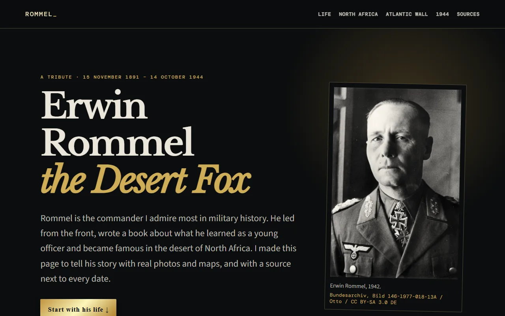

# My first portfolio

This is the portfolio site I built by hand to show my work: four projects with screenshots, three projects I am building now, a short text about me and a button to download my CV. It is plain HTML and CSS, with no framework and no JavaScript.

I am Nicolás Fernando Suárez Cortés, an 18-year-old Data Science Engineering student at Universidad EAN in Bogotá. This was my first portfolio, and I kept it as my own code on purpose, even after I learned better ways to do some things.



## What is on the page

1. Hero: my name, one paragraph about what I study and do, a link to the projects and a link to download my CV as a PDF.
2. About me: a quick-facts box (age, city, studies, languages) and three short paragraphs.
3. Outside the code: history, Sherlock Holmes, calisthenics, basketball, Formula 1 and 3D printing.
4. Projects: four project cards with a screenshot each:
   - I. Tribute page to Erwin Rommel (`../tribute-rommel`)
   - II. Formula 1 technical documentation (`../documentation-f1`)
   - III. Landing page for a fictional instrument shop (`../instruments-website`)
   - IV. RedeAgora, a case study with fictional data in Excel and Power BI
5. What I am building now: three text cards with no links, because these projects are not public yet: Aleph, the El Niño prediction and ODIN.
6. Contact: the CV download and the email, LinkedIn and GitHub rows, marked "Coming soon".

`projects.html` is the second page, with all 21 small sites and my courses.

## How to run it

You only need a web browser.

**Option 1, the quickest:** double-click `index.html`. The page opens, but the links to the other projects (`../tribute-rommel/...`) only work if the other project folders are next to this one, like they are in my `Projetos-Web` folder.

**Option 2, the way I test it:** run a small local server from the `Projetos-Web` folder (the parent folder) so every link between projects works. With Python installed on Windows:

```bash
py -m http.server 8765 --directory C:\Users\ferna\OneDrive\Documents\Projetos-Web
```

Then open http://localhost:8765/first-portfolio/index.html. Stop the server with `Ctrl+C`.

## How it is built

```
first-portfolio/
├── index.html        main page
├── projects.html     all projects and courses
├── styles.css        all the styles (one file for both pages)
├── images/           screenshots of my projects
├── cv/               my CV as a PDF
└── PORTFOLIO_REVIEW.md   notes from a review of the site (not published)
```

- Colours live in CSS variables at the top of `styles.css` (`--ink`, `--gold`, `--paper`…). Changing one there changes it everywhere.
- Fonts come from Google Fonts: Playfair Display for headings, Source Sans 3 for text, DM Mono for the small labels and Cinzel for the gold buttons.
- Layout: the project cards are CSS Grid with two columns (`40% 60%`, and `.reverse` flips it). Under 992 px wide they turn into one column with flexbox, so the page works on a phone.
- Movement: everything is CSS transitions, no JavaScript. The menu links draw a gold line under them on hover, the project cards lift a little, the arrows in the links move to the right and the "building now" cards light up their top border. If the visitor has "reduce motion" turned on in their system, `@media (prefers-reduced-motion: reduce)` switches all transitions off.
- Screenshots were taken in November 2026 from my local files with Microsoft Edge in headless mode (1280 × 800) and saved as WebP, which is much lighter than PNG.
- The CV (`cv/CV_Fernando_Web_EN.pdf`) is exported from my Word file `Emprego/cv_v3/CV_Fernando_Web_EN.docx`. If the CV changes, I have to export the PDF again.

## What I learned making it

- Semantic HTML: `header`, `nav`, `main`, `section`, `article` and `footer` instead of `div` everywhere. I had written `<artcile>` by mistake in four cards and the browser just treated it as an unknown tag, without any error. Now I check my tags.
- CSS Grid for two-column cards and how to switch to one column with a media query.
- CSS variables so the whole site keeps the same colours.
- That `width` and `height` on an `` need `height: auto` in the CSS, or the image keeps its full height on a small screen. I found that bug while testing on a phone width.
- `loading="lazy"` for images below the first screen, so the page opens faster.
- That a portfolio should say only what I can prove. My first version had words like "elite" and "enterprise-grade" and a quote I could not find a source for. I rewrote it in my own words.

## Honest limits

- The email, LinkedIn and GitHub links are not there yet. They say "Coming soon" until I add them (search for `TODO(ferna)` in `index.html`).
- The CV PDF still shows `[e-mail] [WhatsApp] [LinkedIn] [GitHub]` as placeholders. I need to fill them in the Word file and export it again.
- Project IV has no repository link yet (there is a `TODO(ferna)` comment). Aleph, El Niño and ODIN have no links because they are not public.
- The links to the other projects are relative (`../tribute-rommel/index.html`). They work on my computer and in the `Projetos-Web` repository, but if this folder is published alone they will break. Before publishing it alone, they have to point to the public URL of each project.
- `projects.html` was not updated in this round. It still has older text, some empty credential links and a link to `../Project01/README.md` that does not exist inside this folder.
- Google Fonts loads from Google's servers, so a visitor's browser connects to Google.
- I tested it in Edge and in the browser inside the Claude app at 375, 768 and 1440 px wide. I did not test it with a screen reader or on a real phone.
- All companies and brands in my projects are fictional. FranceCop S.A.S. is a name I made up and use in my practice projects; it is not a real company.

## Last update

21 November 2026. The old version of this README is in `_quarentena/2026-11-21/README.old.md` (that folder is not published).
